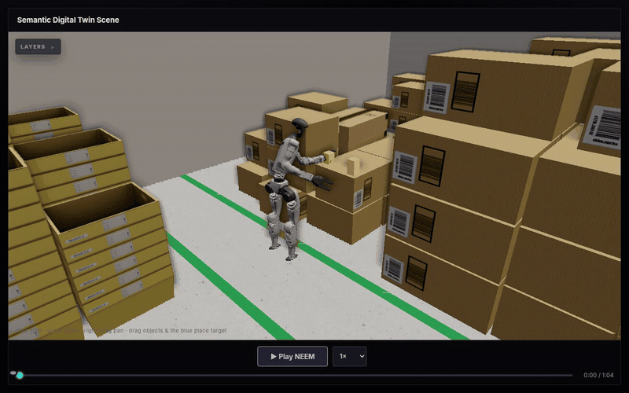

# cramera

**Watch a CRAM robot plan run — recorded or live — in the browser, and ask the scene what happened.**

[](https://sunava.github.io/cramera/)

**[Open the live demo](https://sunava.github.io/cramera/)** · [Changelog](CHANGELOG.md) · [Source in the CRAM monorepo](https://github.com/sunava/cognitive_robot_abstract_machine/tree/cramera-port/cramera)

cramera is the visualization front end of the [CRAM](https://github.com/cram2/cognitive_robot_abstract_machine)
cognitive architecture. One tool, three ways to look at a robot:

- **Recorded.** Run a coraplex demo once through the onboarder and get a self-contained
  scene bundle — URDFs, meshes and the real recorded giskardpy trajectory — that replays in
  any browser. No ROS, no simulator, no Python needed to watch it (the demo site above is
  exactly that: static files).
- **Live.** Attach the viewer to a running demo and it renders the executing world as it
  moves: plan steps light up as they run, motion statecharts stream in, and dragging an
  object in the viewer writes its pose back into the demo's world.
- **Asked.** Type a question in English — *which arm picked up the milk?* — and the EQL
  console matches it to a query over the recorded episode, answers it, shows where the
  answer comes from, points an arrow at the object, and can replay the moment.

It also ships a **Plan Builder**: compose a plan by drag and drop, place objects and
targets in the live 3D scene, attach plain-language constraints, and generate a runnable
`RobotDemonstration`.

## Quick start

cramera lives inside the CRAM monorepo; this repository is a read-only mirror of its
`cramera/` directory, kept in sync by a scheduled workflow.

```bash
git clone https://github.com/sunava/cognitive_robot_abstract_machine.git
cd cognitive_robot_abstract_machine
pip install -e cramera
cramera                                              # serves http://localhost:8711
```

Ready-made recordings live in [cram2/cram-scenes](https://github.com/cram2/cram-scenes);
initialize the optional submodule to get them locally:

```bash
git submodule update --init cramera/scenes
```

Record and watch a demo of your own:

```bash
cramera-onboard path/to/demo.py --name my_scene     # record a demo once, get a bundle
cramera-live path/to/demo.py                        # run a demo with the live bridge attached
cramera-live --viewer path/to/demo.py               # start the viewer and demo together
```

For a saved Plan Builder demo, run
`cramera-live --viewer coraplex/demos/coraplex_generated/my_demo.py`.
The viewer opens in the browser and attaches when the world's bridge is ready.
Ctrl-C stops the demo wrapper and the viewer it started. Use
`--viewer-port 8712` when port 8711 is occupied, or omit `--viewer` to use a viewer
you already started. Both commands support `--help`.

See the [single-robot rehearsal guide](docs/single_robot_rehearsal.md) for scene
editing, semantic placement, offline playback and remaining integration checks.

The packaged laboratory is also available as a reusable CRAM planning world,
with no robot or with ordinary `RobotSpecification` entries. Run
`python -m cramera.examples.laboratory_world --robot pr2` in your CRAM environment,
or see [loading the laboratory as a world](docs/photorealistic_laboratory.md#als-allgemeine-cram-welt-verwenden)
for direct imports, existing-world integration and the separate contact-physics mode.

For the prepared single-robot presentation, run `./scripts/start_cramera_offline.sh`
from the monorepo root. The [offline presentation guide](docs/offline_presentation.md)
describes its six recorded chapters, local asset checks and isolated launch.

A small semantic Transport rehearsal is included. With the Tracy model installed,
run this from the monorepo root:

```bash
cramera-live --viewer cramera/src/cramera/semantic_transport_demo.py
```

It uses CRAM's normal grasp and motion execution to place a cube on an annotated
table, resolving the destination at run time.

For the full mobile Transport scenario, with the PR2 model installed:

```bash
cramera-live --viewer cramera/src/cramera/mobile_transport_demo.py
```

The existing `TransportAction` requests pickup, carrying navigation and placement
on the named `delivery_table`, resolved at execution time. Native collision
avoidance remains enabled throughout. See the
[PR2 Transport validation report](docs/pr2_transport_validation_2026_09_16.md)
for measured results and remaining limits.

The ordinary Plan Builder also completes PR2 transport in the installed apartment,
including a moved object, carrying navigation and release on a named semantic
table. See the [Builder transport validation](docs/builder_transport_validation_2026_09_21.md)
for the saved recording, measured results and remaining browser/test boundaries.

The Builder also supports several named robots in one world, including multiple
instances of the same model. Each robot has its own plan and can be selected for
sequential execution with native collision avoidance. See the
[multi-robot guide](docs/multi_robot.md) for the two-PR2 Transport demo, authoring
steps and current limits.

For continuous navigation around an obstacle, with the PR2 model installed:

```bash
cramera-live --viewer cramera/src/cramera/navigation_demo.py
```

The normal Navigate action combines CRAM's existing free-space planning and
Giskard controllers, with collision avoidance throughout the simulated drive.
Height-aware footprints include carried objects. Omnidirectional bases holding
their joint posture can leave or approach tight endpoints with a fixed heading,
completing required turns in free space before the final approach. See the
[navigation rehearsal](docs/single_robot_rehearsal.md#included-obstacle-navigation)
for the supported behavior and planning bounds.

The viewer looks for bundles in `CRAMERA_SCENES=/path`, then the `cramera/scenes`
submodule, then `~/.cramera/scenes` (where the onboarder writes). Pick a scene with
`?scene=<name>`.

## Import an Isaac Sim / USD scene

`cramera-import` turns a USD stage (`.usd`, `.usda`, `.usdc`, for example an Isaac Sim
twin) into a self-contained scene bundle of its environment, which the viewer shows and
CRAM loads as a world; the robots that act in it are added by CRAM, not by the import.
It needs the `usd` extra (usd-core, trimesh, numpy, scipy, Pillow):

```bash
pip install -e "cramera[usd]"
cramera-import path/to/lab.usda --name my_lab \
  --environment-name "My lab" --task "Cell 01, static" \
  --camera-position 8.7 -5.9 2.95 --camera-target -2.6 0.9 0.7 --camera-fov 61.6
```

The bundle lands in `<scenes directory>/my_lab/` and the `index.json` next to it is
refreshed. Without `--out` the scenes directory is the one the viewer reads
(`CRAMERA_SCENES`, else the scenes submodule, else `~/.cramera/scenes`). To share scenes,
point `CRAMERA_SCENES` at a shared folder for both the import and the viewer:

```bash
export CRAMERA_SCENES=/shared/cramera_scenes
cramera-import lab.usda --name my_lab      # writes /shared/cramera_scenes/my_lab/
cramera                                    # then open index.html?scene=my_lab
```

| Option | Meaning |
| --- | --- |
| `--name NAME` | bundle name: letters, digits, `_` and `-` (required) |
| `--out DIR` | scenes directory to write into |
| `--prim PATH` | convert only this prim's subtree; repeatable |
| `--exclude PRIM` | leave out this prim's subtree; repeatable |
| `--keep-robots` | keep the robots the stage marks in the environment (left out by default) |
| `--environment-name`, `--task` | the scene's labels in the viewer's picker |
| `--exposure` | tone-mapping exposure (default 0.72) |
| `--camera-position X Y Z`, `--camera-target X Y Z` | initial view, given together; `--camera-fov DEGREES` (vertical) only with both. Without them the stage's first camera is used, else a view framing the bulk of the geometry |
| `--variant PRIM SET VARIANT` | select a variant in memory (the file is not changed); repeatable |
| `--trace FILE.npz` | play back a recorded body trace (`bodies`, `pos`, `quat` w-first, `sample_hz`) instead of the stage's time samples |
| `--fps` | playback rate (default 30) |
| `--robot PRIM` | the robot's root link; the robot becomes a model of its own with a base pose track, kept although the stage marks it |
| `--record FILE.json` | a run record whose steps become the timeline segments |

**Robots stay out by default.** A prim the stage marks as a robot is left out with
everything below it: Isaac Sim's robot schema (`IsaacRobotAPI`) applied to the prim, or
an `sdt:entityType` of exactly `Robot`. A `--prim` that is a robot, or lies inside one or
inside an `--exclude`, is refused. Joints from the environment to a robot's bodies
are dropped, so whatever a robot held stays where the stage puts it, fixed to the world.
`conversion_report.json` lists every prim left out and why (`excluded`). A twin without
these marks needs `--exclude`, for example `--exclude /World/Robots` when that scope
holds only robots; when it also holds environment parts (a pedestal, a rail), exclude
the robot prims themselves.

Two more lists in the report, also printed after the conversion, point at robot parts
the marks miss:

- `detached`: every converted body that hung from a left-out body, with the joint that
  held it and the movable joints below it. A held object has none. A body that still
  moves parts, such as a gripper the stage puts beside the robot's marked prim, is a
  part of the robot and needs `--exclude`.
- `articulations`: every articulation root converted outside the marked robots, with
  its movable joints. Doors and stations are articulations too; a robot the stage does
  not mark is one of them and needs `--exclude`.

A recorded run is a demo rather than an environment: `--robot` keeps the robot it
replays, and `--keep-robots` keeps the other marked robots in the environment as well.
For example:

```bash
cramera-import demo.usda --name my_lab_run --variant /World/Robot Physics physics \
  --trace demo_trace.npz --robot /World/Robot --record demo_record.json
```

Isaac stages often print thousands of warnings about material bindings without
`MaterialBindingAPI`; `USD_SHADE_MATERIAL_BINDING_API_CHECK=allowMissingAPI` silences
them, and the bindings are used either way.

What carries over:

- **Geometry** in metres with Z up (other units and Y-up stages are converted), including
  instanced prims. Guide, proxy and invisible prims are skipped.
- **Joints**: physics joints become revolute, prismatic, continuous and fixed joints in
  `environment.urdf`, with one link per rigid body or referenced asset.
- **Materials**: OmniPBR, OmniSurface, OmniGlass and UsdPreviewSurface become glTF PBR
  materials with their textures. An unknown shader shows magenta and is listed in
  `conversion_report.json`.
- **Glass** (OmniGlass, and OmniSurface with transmission) is drawn as a blended,
  reflecting surface, since the browser viewer (three.js r128) cannot refract: it covers
  what lies behind it by its reflectance, tint (colour or average texture colour) and
  frosting, so thin clear glass can look almost invisible. The authored transmission,
  index of refraction, base colour and metalness stay in the GLB material's `extras`,
  and glass casts no shadow.
- **Emission**: the emissive colour is scaled by intensity / 1000 nits, a reference that
  is not calibrated. Anything brighter is stored as `KHR_materials_emissive_strength`,
  which the viewer ignores. Glowing surfaces do not light the scene.
- **Lights**: the brightest distant light, the brightest dome light and every rect light go
  to `lighting.json`, from which the viewer builds its environment and key light. Disk,
  sphere and cylinder lights are dropped.
- **Animation**: the stage's time samples, or the `--trace`, become joint values per
  frame, taken from the nearest recorded sample without interpolation. Moving free bodies
  become objects. The import replays the result against the recording and writes the
  differences to `residuals.csv`. Animated emission (stack lights), `state:*` attributes
  and the record's events are not carried over.
- **Semantics**: `sdt:` and `ont:` attributes go to `semantics.json` and to the extras of
  the GLB nodes.

Not yet carried over: collision geometry (the URDF has no `<collision>` elements, so a
CRAM world built from the bundle has nothing to collide with). The laboratory share,
offline export and demo site do not copy `lighting.json` yet, so a scene shared that
way falls back to the studio lighting.

To plan or ask questions in the scene, load it as a CRAM world:

```bash
python -m cramera.examples.usd_scene_world --scene my_lab          # print what the world holds
python -m cramera.examples.usd_scene_world --scene my_lab --live   # serve it to the viewer
```

`--bundle-directory DIR` loads a bundle by path instead of by name, and `--port` sets the
live bridge port; with `--live` the example prints the viewer address to open. In Python,
`UsdSceneEnvironment.from_scene_name("my_lab").create_world(robots=[...])` (from
`cramera.usd_scene_world`) builds the world with your planning robots; the bundle's
recorded robot is not loaded. Every prim with semantics becomes a `UsdPrimAnnotation`,
queried in EQL as `prim`, and some `sdt:class` values also become semantic_digital_twin
classes (fridge, shelf, sink, houseplant, desk, cabinet, table).

## What is in the box

| | |
| --- | --- |
| `robot-scene` panel | three.js scene: environment, robot, draggable objects, TF frame triads, ROS debug markers, playback with key-moment marks and thumbnails, live controls, recording |
| `eql` panel | the question console: English in, EQL query and answer out, spoken if you like |
| `graph` panel | Knowledge · Plan (step tree with live status and constraints) · Statechart · Kinematics · Transforms |
| Models page | the probabilistic-model workbench: query, posterior and mode side by side |
| Plan Builder page | compose a plan, place things in the scene, generate a demo |
| Sandbox page | teleoperation by hand tracking |

## How the UI is composed

The front end (`src/cramera/web/`) is a set of **panels** mounted into layout slots;
`web/config.js` decides which panel appears where. Panels never call each other — they
publish and subscribe on an event bus (`web/core/bus.js`), so any subset works, and a
new visualization is one `Panels.define(...)` plus a line in the config.

```
src/cramera/
  server.py        static front end + JSON API (/api/knowledge, /api/eql, /scenes/)
  knowledge/       the recorded scene as an EQL knowledge base; presets; graph views
  live/            stream a running coraplex demo into the viewer (bridge on :8765)
  onboard/         turn a demo run into a scene bundle
  web/             index.html, config.js, core/, panels/, vendor/ (all local, no CDN)
```

## Tests

```bash
pytest test/cramera_test
```

The JS core is covered by node-based tests invoked from pytest (skipped when node is
unavailable).

## About this mirror

The source of truth is the monorepo branch
[`cramera-port`](https://github.com/sunava/cognitive_robot_abstract_machine/tree/cramera-port);
`.github/workflows/sync.yml` splits its `cramera/` directory into this repository's
`main` every six hours, and `pages.yml` publishes the demo site from it. Please open
issues and pull requests against the monorepo.

cramera is developed by [Vanessa Hassouna](https://github.com/sunava) at the Institute for
Artificial Intelligence, University of Bremen. GPL-3.0.
